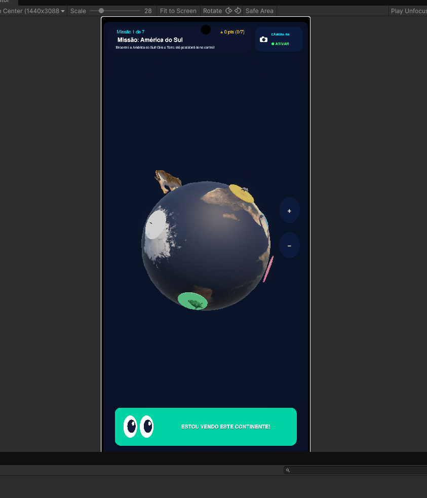
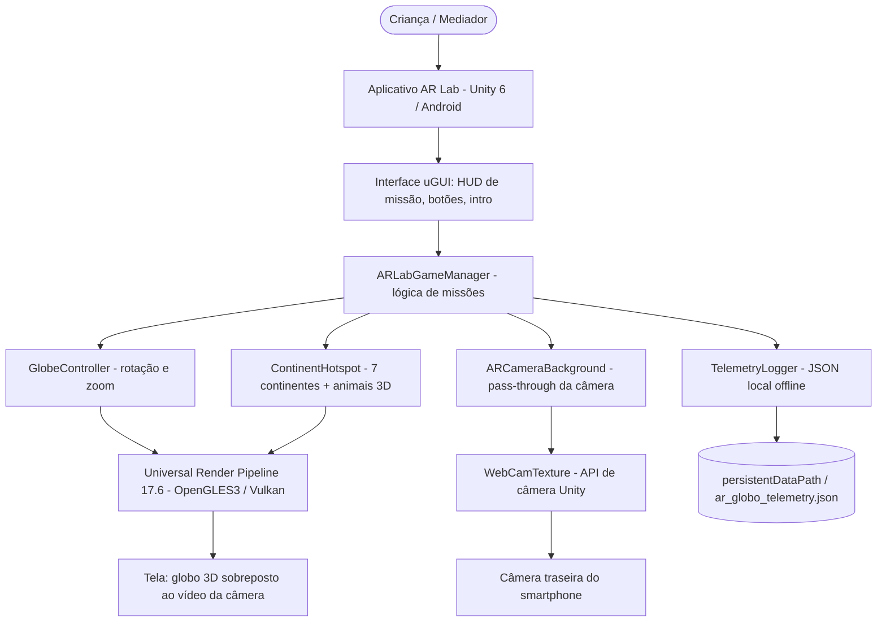
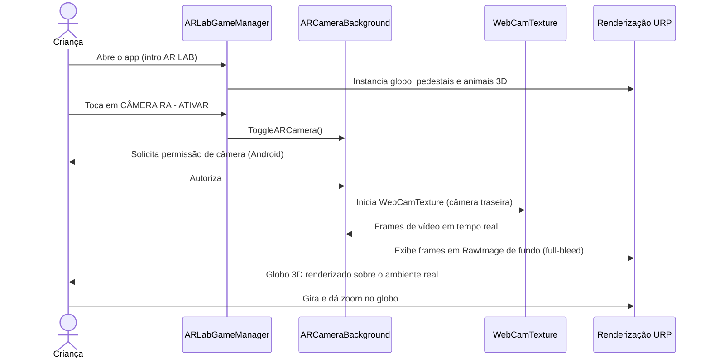
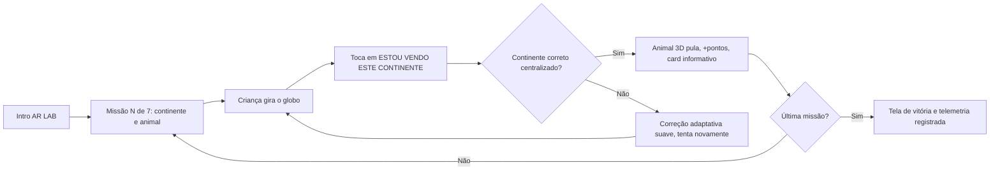
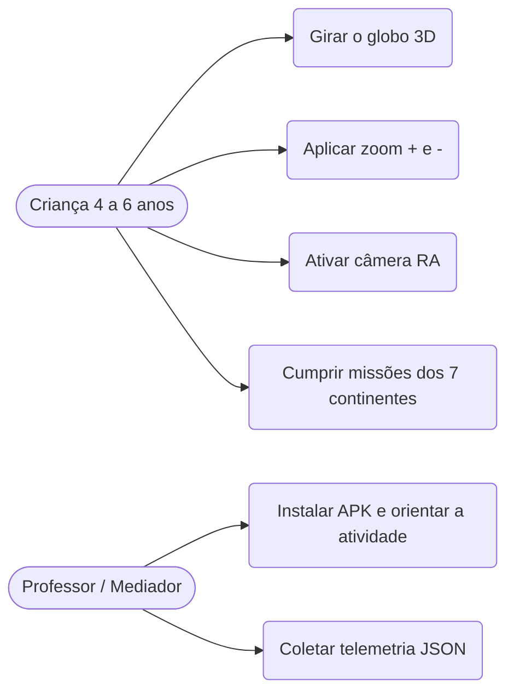
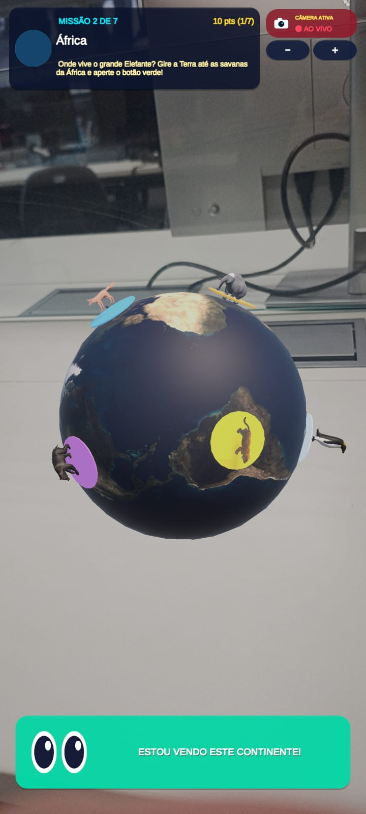
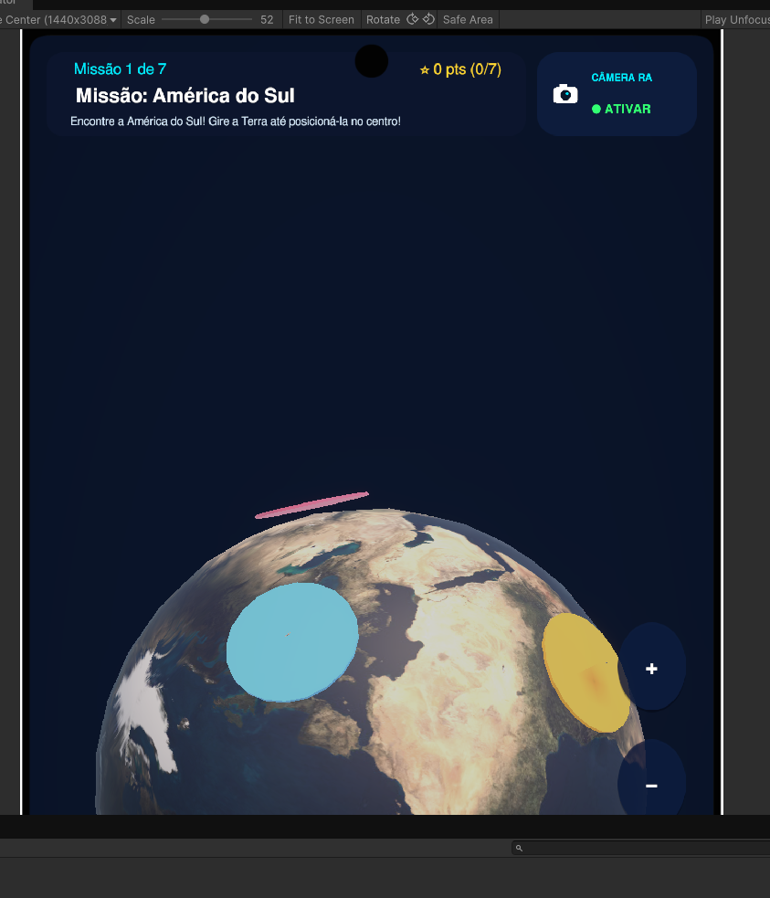
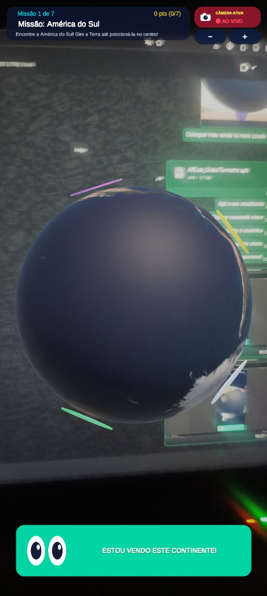

# AR Lab — Globo Terrestre Interativo em Realidade Aumentada

> **UPX — Realidade Aumentada** · Centro Universitário Facens
> Aplicativo Android em Unity 6 que apoia o ensino de Geografia na Educação Infantil por meio de um globo terrestre 3D interativo, missões gamificadas dos 7 continentes e fundo de câmera em tempo real (pass-through).


---

## Sumário

1. [Identificação do Projeto](#1-identificação-do-projeto)
2. [Visão Geral](#2-visão-geral)
3. [Problema](#3-problema)
4. [Objetivos](#4-objetivos)
5. [Público-Alvo](#5-público-alvo)
6. [Funcionalidades](#6-funcionalidades)
7. [Requisitos Não Funcionais](#7-requisitos-não-funcionais)
8. [Tecnologias Utilizadas](#8-tecnologias-utilizadas)
9. [Hardware Utilizado](#9-hardware-utilizado)
10. [Arquitetura do Sistema](#10-arquitetura-do-sistema)
11. [Funcionamento da Realidade Aumentada](#11-funcionamento-da-realidade-aumentada)
12. [Estrutura do Projeto](#12-estrutura-do-projeto)
13. [Principais Scripts e Componentes](#13-principais-scripts-e-componentes)
14. [Dependências](#14-dependências)
15. [Configuração do Ambiente](#15-configuração-do-ambiente)
16. [Como Executar o Projeto](#16-como-executar-o-projeto)
17. [Como Utilizar a Aplicação](#17-como-utilizar-a-aplicação)
18. [Diagramas](#18-diagramas)
19. [Interface da Aplicação](#19-interface-da-aplicação)
20. [Testes Técnicos](#20-testes-técnicos)
21. [Dispositivos Testados](#21-dispositivos-testados)
22. [Limitações Conhecidas](#22-limitações-conhecidas)
23. [Evidências de Funcionamento](#23-evidências-de-funcionamento)
24. [Problemas Encontrados e Soluções](#24-problemas-encontrados-e-soluções)
25. [Cronograma Técnico](#25-cronograma-técnico)
26. [Controle de Versão](#26-controle-de-versão)
27. [Referências e Documentos Complementares](#27-referências-e-documentos-complementares)

---

## 1. Identificação do Projeto

| Item | Informação |
|---|---|
| **Projeto** | AR Lab — Globo Terrestre Interativo em Realidade Aumentada (artefato `AR-Globo Kids`) |
| **Equipe** | Equipe AR Lab (UPX 8) |
| **Curso** | Engenharia de Computação |
| **Instituição** | Centro Universitário Facens — Sorocaba/SP |
| **Disciplina** | UP801TIN3 — UPX: Realidade Aumentada |
| **Professor** | Prof. Dr. Ohata |
| **Semestre** | 2026.2 |
| **Repositório** | <https://github.com/DJmesh/Ar-Lab-Unity> |

### Integrantes

| Nome | RA | Responsabilidade técnica |
|---|---|---|
| Eduardo Augusto Prestes Júnior | 252148 | Arquitetura do projeto Unity, programação C# (`ARLabGameManager`, `GlobeController`, `ARCameraBackground`), configuração URP, geração do APK Android e controle de versão |
| Eduardo Cunha Soares | 223988 | Desenvolvimento, integração de componentes e pesquisa bibliográfica |
| Leonardo de Arruda Macedo | 223798 | Modelagem 3D, texturização dos modelos e UX pedagógica |
| Matheus de Souza | 224282 | Desenvolvimento de mecânicas de jogo e telemetria científica (`TelemetryLogger`) |
| Guilherme Augusto Ferreira | 223291 | Testes de validação, QA e documentação técnica |

---

## 2. Visão Geral

O **AR Lab** é um aplicativo educacional para smartphones Android destinado a crianças de **4 a 6 anos**. Ele substitui o uso exclusivo de mapas e planisférios impressos (bidimensionais) por um **globo terrestre tridimensional** que a criança gira e amplia com os dedos, explorando os **7 continentes** por meio de missões lúdicas.

Em cada missão o aplicativo apresenta um continente e o animal que o representa (ex.: onça-pintada na América do Sul, elefante na África, pinguim na Antártida). A criança gira o globo até posicionar o continente no centro da tela e toca em **“Estou vendo este continente!”**. O acerto é celebrado com animação do animal 3D e pontuação; o erro gera uma **correção adaptativa suave**, sem punição.

A Realidade Aumentada participa por meio do **modo Câmera RA**: a câmera traseira do aparelho é exibida em tela cheia, em tempo real, atrás do globo 3D, fazendo com que o globo pareça flutuar sobre a carteira ou a sala de aula. A abordagem técnica é de **sobreposição sobre vídeo ao vivo (camera pass-through)**, detalhada na [seção 11](#11-funcionamento-da-realidade-aumentada).



---

## 3. Problema

**Contexto.** Na pré-escola (4 a 6 anos), a criança está em transição da percepção do espaço vivido para a representação simbólica do espaço geográfico. O ensino inicial de Geografia, porém, recorre majoritariamente a **cartazes, livros e planisférios planos**.

**Dificuldade.** Esses recursos estáticos exigem abstração e leitura de códigos cartográficos que a criança ainda não domina, e não permitem observar a esfericidade da Terra nem manipulá-la. Isso reduz o engajamento e dificulta a fixação da localização dos continentes e da fauna associada.

**Público afetado.** Crianças da educação infantil e seus professores, especialmente em **escolas públicas**, onde há pouco acesso a materiais didáticos tridimensionais ou a equipamentos de realidade virtual de alto custo.

**Impacto.** Menor engajamento e baixa retenção de conceitos espaciais básicos. O projeto se alinha ao **ODS 4 (Educação de Qualidade), meta 4.2**, propondo uma ferramenta de baixo custo que roda em smartphones Android comuns.

---

## 4. Objetivos

### 4.1 Objetivo Geral

Desenvolver e validar um aplicativo Android em Unity que utilize um globo terrestre 3D interativo, apoiado por câmera em tempo real, para mediar o aprendizado dos 7 continentes por crianças de 4 a 6 anos.

### 4.2 Objetivos Técnicos

- Configurar um projeto Unity 6 com Universal Render Pipeline voltado a Android.
- Renderizar um globo terrestre 3D texturizado, com rotação por arrasto e inércia.
- Permitir zoom por gesto de pinça, por botões **+** / **−** e por roda do mouse, com limites de escala.
- Posicionar sobre o globo 7 marcadores (pedestais) com modelos 3D de animais proporcionais e visíveis.
- Implementar missões gamificadas com validação de continente, feedback positivo e correção adaptativa.
- Exibir o feed da câmera traseira em tempo real atrás do globo (modo RA).
- Registrar telemetria de uso localmente e de forma anônima (offline).
- Gerar o APK e executá-lo em um smartphone Android físico.
- Documentar instalação, execução, testes e limitações.

---

## 5. Público-Alvo

| Aspecto | Descrição |
|---|---|
| **Usuário final** | Crianças de 4 a 6 anos (pré-escola), ainda sem leitura fluente |
| **Mediador** | Professor(a) ou responsável que instala o APK e conduz a atividade |
| **Contexto de uso** | Sala de aula ou ambiente doméstico, em smartphone Android, com a criança em pé ou sentada |
| **Necessidades** | Interação tátil simples, elementos grandes e coloridos, instruções curtas e alegóricas, feedback imediato e positivo |
| **Limitações** | Baixa leitura e coordenação motora fina em desenvolvimento → botões grandes, textos ampliados e sem penalidade por erro |
| **Familiaridade tecnológica** | Baixa a média; o mediador apenas instala o aplicativo |

A fundamentação teórica e a metodologia experimental planejada estão no artigo científico em [`docs/documents/`](docs/documents/artigo_cientifico_v1.docx).

---

## 6. Funcionalidades

| ID | Funcionalidade | Descrição | Status |
|---|---|---|---|
| RF01 | Tela de abertura animada | Intro “AR LAB” com globo girando, logotipo e transição para a HUD; toque para pular | ✅ |
| RF02 | Globo 3D interativo | Globo texturizado com rotação por arrasto, inércia e eixo Y invertido para naturalidade | ✅ |
| RF03 | Zoom do globo | Botões **+** / **−**, pinça e roda do mouse, com escala mínima e máxima | ✅ |
| RF04 | Animais 3D nos continentes | 7 modelos 3D (Onça, Elefante, Raposa, Panda, Tartaruga, Urso, Pinguim) sobre pedestais coloridos, em escala uniforme | ✅ |
| RF05 | Missões dos 7 continentes | Cartão de missão com animal, continente e instrução alegórica em fonte ampliada | ✅ |
| RF06 | Validação de continente | Botão “Estou vendo este continente!” verifica o continente centralizado na tela | ✅ |
| RF07 | Feedback e correção adaptativa | Animal 3D comemora o acerto; erro é corrigido suavemente sem punição | ✅ |
| RF08 | Pontuação e tela final | Score, contagem de acertos e painel de vitória com “Jogar novamente” | ✅ |
| RF09 | Câmera RA (pass-through) | Exibe a câmera traseira em tempo real atrás do globo, com botão Ativar/Desativar | ✅ |
| RF10 | Telemetria local | Registra duração, rotações, cliques, acertos e nota Smilyometer em JSON local | ✅ |
| RF11 | Escala Smilyometer | Avaliação pictórica de satisfação (componente `SmilyometerUI`) — ainda não integrada ao fluxo principal | 🚧 |
| RF12 | Posicionamento em superfície real | Ancoragem do globo em plano detectado (`ARPlacementManager` com AR Foundation) — depende de pacote não instalado | ⬜ |
| RF13 | Experimento em campo | Aplicação em turmas reais e análise dos dados de telemetria | ⬜ |

**Legenda:** ✅ Implementado · 🚧 Em desenvolvimento · ⬜ Planejado · ❌ Cancelado

---

## 7. Requisitos Não Funcionais

| ID | Categoria | Requisito | Situação |
|---|---|---|---|
| RNF01 | Compatibilidade | Executar em Android 8.0 (API 26) ou superior, arquitetura ARM64 | Configurado no projeto (`AndroidMinSdkVersion: 26`); verificado em 1 aparelho |
| RNF02 | Desempenho | Manter fluidez suficiente para interação tátil em smartphones comuns | Percebida como fluida nos testes manuais; **FPS não medido formalmente** |
| RNF03 | Usabilidade | Interface com textos grandes, botões amplos e linguagem alegórica para crianças | Atendido (fontes de 25 a 38 pt na HUD) |
| RNF04 | Privacidade | Dados de uso anonimizados e armazenados apenas no dispositivo (LGPD) | Atendido (arquivo local, sem rede) |
| RNF05 | Conectividade | Funcionar 100% offline | Atendido |
| RNF06 | Hardware | Dispositivo com câmera traseira para o modo RA e suporte a OpenGLES 3.0 ou Vulkan | Configurado |
| RNF07 | Documentação | Repositório deve permitir que terceiros configurem e executem o projeto | Este documento |

---

## 8. Tecnologias Utilizadas

| Tecnologia | Versão | Utilização |
|---|---|---|
| Unity Editor | 6000.6.0f1 (f7f8ed4d1e24) | Desenvolvimento principal, cena e build |
| C# | compatível com Unity 6 (.NET Standard 2.1) | Scripts da aplicação |
| Universal Render Pipeline (URP) | 17.6.0 | Renderização 3D otimizada para dispositivos móveis |
| Unity UI (uGUI) | 2.6.0 | HUD, botões, cartões e animações de interface |
| Input System | 1.20.0 | Entrada de toque, mouse e simulação |
| `WebCamTexture` (Unity Engine API) | embutido no Unity 6 | Captura da câmera traseira para o modo RA |
| Android Build Support (SDK/NDK/OpenJDK) | instalados pelo Unity Hub (Java 17) | Geração do APK |
| Scripting Backend | IL2CPP, ARM64 | Compilação nativa do APK |
| Modelos 3D (`.fbx`, `.obj`, `.glb`) | — | Globo terrestre e 7 animais |
| Git | 2.x (desenvolvido com 2.55.0) | Controle de versão |
| GitHub | — | Hospedagem do código e da documentação |
| Ubuntu Linux | 24.04.4 LTS | Sistema operacional de desenvolvimento |

---

## 9. Hardware Utilizado

| Equipamento | Característica relevante | Utilização |
|---|---|---|
| Computador de desenvolvimento | Ubuntu 24.04.4 LTS, 30 GiB de RAM | Desenvolvimento Unity, simulação e geração do APK |
| Smartphone Android | Android 8.0+ com câmera traseira; APK instalado diretamente (sideload) | Testes reais do modo câmera RA e dos controles de toque |
| Unity Device Simulator | Perfil “Punch Hole Center (1440x3088)” | Testes de layout e interação no Editor |

> Compatibilidade só é declarada para equipamentos efetivamente utilizados. Veja a [seção 21](#21-dispositivos-testados).

---

## 10. Arquitetura do Sistema

A arquitetura é organizada em camadas: interface, lógica de jogo, módulos de globo/RA/telemetria, renderização e hardware do aparelho. **Não há servidor, API ou banco de dados** (funcionamento 100% offline).



Fonte do diagrama: [`docs/diagrams/arquitetura.mmd`](docs/diagrams/arquitetura.mmd).

**Fluxo resumido:** Criança → Aplicativo → Interface → `ARLabGameManager` → `GlobeController` / `ContinentHotspot` / `ARCameraBackground` → URP → Tela; câmera: `WebCamTexture` → câmera traseira.

---

## 11. Funcionamento da Realidade Aumentada

### 11.1 Abordagem utilizada

O projeto implementa **Realidade Aumentada por sobreposição sobre vídeo ao vivo (camera pass-through / video see-through)**, sem rastreamento espacial:

- O vídeo da **câmera traseira** é capturado pela API `WebCamTexture` do Unity.
- Cada quadro é exibido em um `RawImage` de tela cheia (*full-bleed*), em um Canvas posicionado **atrás** da cena 3D.
- O globo 3D, os pedestais e os animais são renderizados pela câmera Unity (URP) **por cima** do vídeo, criando a percepção de que o globo flutua sobre o ambiente real.

> **Importante (transparência técnica):** esta versão **não utiliza AR Foundation, ARCore ou ARKit**. Não há *Image Tracking*, *Plane Detection* nem ancoragem do globo ao mundo real; o globo permanece fixo no centro da tela e se move conforme o gesto do usuário, não conforme a posição do aparelho. O script `ARPlacementManager` contém a lógica de ancoragem em planos, mas está **desativado por diretiva de compilação** (`#if ENABLE_AR_FOUNDATION`) porque o pacote AR Foundation não está instalado no `Packages/manifest.json`. A evolução para *Plane Detection* está listada como [RF12](#6-funcionalidades).

### 11.2 Fluxo técnico



**Em texto:** Usuário abre o app → intro AR LAB → toca em *Câmera RA* → Android solicita permissão → `ARCameraBackground` inicia `WebCamTexture` na câmera traseira → quadros são desenhados em tela cheia atrás da cena → URP renderiza globo e animais por cima → usuário gira, amplia e cumpre as missões sobre o ambiente real.

### 11.3 Componentes responsáveis

| Etapa | Tecnologia / Componente |
|---|---|
| Permissão e captura de câmera | `ARCameraBackground` + `WebCamTexture` + permissão Android `CAMERA` |
| Exibição do vídeo | `RawImage` em Canvas de fundo (ajuste de proporção/rotação do sensor) |
| Renderização do globo e animais | URP 17.6 + `GlobeController` + `ContinentHotspot` |
| Interação | Input System (arrasto, pinça) + botões uGUI |

---

## 12. Estrutura do Projeto

```text
ar lab unity/
├── Assets/
│   ├── Editor/                 # Ferramentas de editor (setup da cena/UI e build do APK)
│   ├── Models/
│   │   ├── Animals/            # Modelos 3D, texturas e normal maps dos animais
│   │   └── Geography/          # Globo terrestre (.glb/.obj), material e textura da Terra
│   ├── Resources/Animals/      # Cópia dos modelos para carregamento em runtime (fallback Android)
│   ├── Scenes/SampleScene.unity# Cena principal
│   ├── Scripts/Geography/      # Scripts C# do jogo, globo, câmera RA e telemetria
│   ├── Settings/               # Perfis URP e volumes de renderização
│   └── XR/                     # Configurações XR / simulação do Editor
├── Packages/manifest.json      # Dependências do Unity Package Manager
├── ProjectSettings/            # Configurações do projeto (versão do Editor, Android, URP)
├── docs/
│   ├── diagrams/               # Diagramas (Mermaid)
│   ├── images/                 # Screenshots e evidências
│   └── documents/              # Artigo científico (versão 1)
├── .gitignore
└── README.md
```

| Pasta | Função |
|---|---|
| `Assets/Scripts/Geography` | Código-fonte de toda a lógica da aplicação |
| `Assets/Editor` | Menu **AR Lab** no Editor: montagem automática da UI e geração do APK |
| `Assets/Models` | Ativos 3D produzidos/importados pela equipe |
| `Assets/Resources/Animals` | Garante que os modelos existam no APK mesmo sem `AssetDatabase` |
| `docs/` | Documentação técnica exigida pela disciplina |

> As pastas `Library/`, `Temp/`, `Logs/`, `Builds/` e `UserSettings/` são geradas automaticamente e **não** são versionadas (ver `.gitignore`).

---

## 13. Principais Scripts e Componentes

| Script | Responsabilidade |
|---|---|
| `ARLabGameManager.cs` | Núcleo da aplicação: monta globo, pedestais, HUD e EventSystem; gerencia as 7 missões, pontuação, validação do continente, feedback, tela final, intro animada e botão de câmera RA |
| `GlobeController.cs` | Rotação por arrasto com inércia (`damping`), zoom por pinça/mouse/botões com limites `minScale`/`maxScale` |
| `ARCameraBackground.cs` | Solicita permissão, inicia `WebCamTexture` e exibe o vídeo em tela cheia atrás do globo (modo RA) |
| `ContinentHotspot.cs` | Representa cada continente: detecção por toque e *flash* de acerto/erro |
| `Animal3DRotator.cs` | Animação de rotação contínua e pulo de comemoração do animal 3D |
| `TelemetryLogger.cs` | Grava sessão em `ar_globo_telemetry.json` (duração, rotações, cliques, acertos, Smilyometer) |
| `SmilyometerUI.cs` | Escala pictórica de satisfação com 5 expressões (em integração) |
| `ExplorerQuizManager.cs` / `RegionHotspot.cs` | Modo de quiz por regiões (módulo auxiliar anterior ao modo de missões) |
| `ARPlacementManager.cs` | Ancoragem do globo em planos via AR Foundation (inativo, ver seção 11) |
| `Editor/SetupARLabUI.cs` | Item de menu que monta e salva a cena/UI no disco |
| `Editor/BuildAndroidAPK.cs` | Item de menu que gera o APK, saindo do Play Mode com segurança |
| `Editor/SetupGlobeScene.cs`, `FindContinentCoordinates.cs` | Apoio à montagem do globo e ao cálculo das coordenadas dos continentes |

---

## 14. Dependências

### Pacotes Unity (`Packages/manifest.json`)

| Pacote | Versão |
|---|---|
| `com.unity.render-pipelines.universal` | 17.6.0 |
| `com.unity.inputsystem` | 1.20.0 |
| `com.unity.ugui` | 2.6.0 |
| `com.unity.timeline` | 6.6.0 |
| `com.unity.ai.navigation` | 2.0.14 |
| `com.unity.test-framework` | 1.8.0 |
| `com.unity.visualscripting` | 1.9.12 |
| `com.unity.collab-proxy` | 2.13.6 |
| `com.unity.ide.visualstudio` / `com.unity.ide.rider` | 2.0.26 / 3.0.38 |
| Módulos `com.unity.modules.*` (física, áudio, UI, XR etc.) | 1.0.0 |

Todos são obtidos automaticamente pelo **Unity Package Manager** ao abrir o projeto. Não há bibliotecas externas de terceiros nem plugins nativos adicionais.

### Pacotes planejados (não instalados)

AR Foundation, ARCore XR Plugin e XR Plugin Management, necessários apenas para o RF12 (detecção de planos).

---

## 15. Configuração do Ambiente

Procedimento para um computador novo:

1. Instalar o **Git** (versão 2.x) — <https://git-scm.com>.
2. Instalar o **Unity Hub** — <https://unity.com/download>.
3. No Unity Hub, instalar o **Unity Editor 6000.6.0f1** (Unity 6). Se a versão não aparecer na lista, usar o *archive* de versões.
4. Durante a instalação, adicionar os módulos:
   - **Android Build Support**
   - **Android SDK & NDK Tools**
   - **OpenJDK**
5. No smartphone Android: ativar **Opções do desenvolvedor** e permitir **instalação de apps de fontes desconhecidas** (ou depuração USB).
6. Clonar o repositório:

```bash
git clone git@github.com:DJmesh/Ar-Lab-Unity.git
# alternativa por HTTPS:
git clone https://github.com/DJmesh/Ar-Lab-Unity.git
```

7. No Unity Hub: **Add → Add project from disk** e selecionar a pasta clonada.
8. Confirmar que a versão do Editor exibida é **6000.6.0f1** e abrir o projeto. Na primeira abertura o Unity importa os assets e baixa os pacotes (pode levar alguns minutos).

**Verificação:** ao final, o Console do Unity não deve exibir erros de compilação (vermelhos) e a pasta `Assets/Scenes/` deve mostrar `SampleScene`.

---

## 16. Como Executar o Projeto

### 16.1 No Editor (simulação)

1. Abrir o projeto no Unity Hub (versão 6000.6.0f1).
2. No painel **Project**, abrir `Assets/Scenes/SampleScene.unity`.
3. Na aba **Game**/**Simulator**, escolher um perfil de celular (ex.: *Punch Hole Center*).
4. Pressionar **▶ Play**. A intro “AR LAB” é exibida e, em seguida, a HUD de missão.
5. Usar o mouse: arrastar gira o globo; a roda do mouse e os botões **+** / **−** ampliam.

> O botão **Câmera RA** usa a webcam do computador no Editor (se disponível).

### 16.2 Gerar o APK para Android

1. Com **Play Mode parado**, abrir o menu **AR Lab → 5. Gerar APK para Celular (Android)**.
2. Aguardar a compilação (IL2CPP, ARM64). O Console exibirá *“Nova APK gerada com sucesso!”*.
3. O arquivo é gerado em `Builds/ARLab_GloboTerrestre.apk`.
4. Transferir o APK para o celular (cabo USB, `adb install` ou compartilhamento) e instalar.

Alternativa pela interface padrão: **File → Build Profiles → Android → Switch Platform → Build**, com `SampleScene` na lista de cenas.

```bash
# instalação via USB (depuração USB ativada)
adb install -r "Builds/ARLab_GloboTerrestre.apk"
```

---

## 17. Como Utilizar a Aplicação

1. **Abrir o aplicativo “AR Lab”.** A animação de abertura é exibida (toque na tela para pular).
2. **Ler a missão** no cartão superior: animal, nome do continente e instrução (ex.: *“Gire o planeta até o Brasil no centro e aperte o botão verde com olhos!”*).
3. **Girar o globo** arrastando o dedo; usar **+** / **−** ou a pinça com dois dedos para ampliar/reduzir.
4. *(Opcional)* Tocar em **CÂMERA RA → ATIVAR**, **autorizar a câmera** e ver o globo sobre o ambiente real. Tocar novamente para desativar.
5. **Centralizar o continente** da missão na tela.
6. Tocar no botão verde **“ESTOU VENDO ESTE CONTINENTE!”**.
7. **Acerto:** o animal 3D comemora, a pontuação sobe e a próxima missão começa. **Erro:** o app orienta suavemente e permite tentar de novo.
8. Após a 7ª missão, a **tela final** mostra a pontuação, com opção **“Jogar novamente”**.

---

## 18. Diagramas

Os diagramas representam o **projeto atual** e estão em [`docs/diagrams/`](docs/diagrams/) (formato Mermaid, renderizados automaticamente pelo GitHub).

### Arquitetura
Apresentada na [seção 10](#10-arquitetura-do-sistema) — [`arquitetura.mmd`](docs/diagrams/arquitetura.mmd).

### Fluxo da Realidade Aumentada
Apresentado na [seção 11](#112-fluxo-técnico) — [`fluxo-ra.mmd`](docs/diagrams/fluxo-ra.mmd).

### Fluxo de uma missão



Fonte: [`fluxo-missao.mmd`](docs/diagrams/fluxo-missao.mmd).

### Casos de uso



Fonte: [`casos-de-uso.mmd`](docs/diagrams/casos-de-uso.mmd).

---

## 19. Interface da Aplicação

> As capturas abaixo foram feitas durante o desenvolvimento. A HUD recebeu refinamentos posteriores (maior afastamento do topo e fontes ampliadas); as capturas devem ser atualizadas após a próxima geração do APK.

| Tela | Finalidade | Principais elementos | Ação do usuário |
|---|---|---|---|
| **Tela principal (missão)** | Conduzir a missão atual | Cartão com missão e pontuação, botão Câmera RA, botões **+**/**−**, globo 3D com animais, botão verde com olhos | Girar o globo e tocar em “Estou vendo este continente!” |
| **Modo Câmera RA** | Sobrepor o globo ao ambiente real | Vídeo da câmera em tela cheia, indicador “CÂMERA ATIVA / AO VIVO” | Ativar/desativar a câmera |
| **Animais 3D nos pedestais** | Associar animal e continente | Pedestais coloridos com modelos 3D | Observar e localizar o continente |
| **Controles de zoom** | Ajustar o tamanho do globo | Botões circulares **+** e **−** | Ampliar/reduzir com limites de escala |
| **Abertura “AR LAB”** | Transição de entrada | Globo, logotipo, subtítulo “Expedição Globo Terrestre” | Aguardar ou tocar para pular |
| **Tela final** | Encerrar a sessão | Pontuação, acertos, botão “Jogar novamente” | Reiniciar a atividade |





---

## 20. Testes Técnicos

Somente testes efetivamente realizados são registrados.

| Teste | Procedimento | Resultado esperado | Resultado obtido | Status |
|---|---|---|---|---|
| Compilação | Abrir o projeto e aguardar a compilação no Editor | Console sem erros CS | Sem erros após correção da string da intro (commit `2ca70b0`) | ✅ |
| Execução no Editor | Play no Device Simulator (*Punch Hole Center*) | Intro, HUD e globo exibidos | Exibidos corretamente | ✅ |
| Rotação do globo | Arrastar com mouse/toque | Globo gira com inércia; eixo Y natural | Funcionou (eixo Y invertido no commit `b98958c`) | ✅ |
| Zoom | Usar **+**, **−**, pinça e roda do mouse | Escala varia dentro dos limites | Funcionou com limites | ✅ |
| Escala dos animais | Inspeção visual dos 7 animais | Todos visíveis, proporcionais, sobre o pedestal | Ajustes sucessivos até escala uniforme (~0,18 m); tartaruga ajustada em `9a6598b` | ✅ |
| Geração do APK | Menu AR Lab → Gerar APK | APK criado sem erro | “Nova APK gerada com sucesso” (~41 MB) | ✅ |
| Build em Play Mode | Gerar APK com Play Mode ativo | Build não deve falhar | Falhava com `InvalidOperationException`; corrigido em `69aa5ce` | ✅ |
| Câmera RA no celular | Instalar APK, ativar Câmera RA | Câmera abre e globo aparece sobre ela | Funcionou (ver evidência) | ✅ |
| Animais 3D no celular | Instalar APK corrigido | Modelos 3D visíveis no aparelho | Correção aplicada em `02d5057`; **reconfirmação no aparelho pendente** | 🚧 |
| Telemetria | Concluir sessão e inspecionar `ar_globo_telemetry.json` | Arquivo JSON criado | Implementado; verificação sistemática pendente | 🚧 |
| Taxa de quadros | Medir FPS no aparelho | ≥ 30 FPS estáveis | Não medido formalmente | ⬜ |
| Experimento com crianças | Aplicar em turma | Coleta de dados | Planejado para etapa posterior | ⬜ |

---

## 21. Dispositivos Testados

| Dispositivo | Sistema | Versão | Resultado |
|---|---|---|---|
| Smartphone Android da equipe (APK instalado por *sideload*) | Android | 8.0+ (API 26+ exigida pelo build) | Câmera RA e interação por toque funcionaram (ver evidência) |
| Unity Device Simulator — Punch Hole Center 1440×3088 | Editor Unity 6000.6.0f1 (Ubuntu 24.04) | — | Layout e interação validados |

> Fabricante, modelo e versão exata do Android do aparelho físico devem ser registrados nesta tabela pela equipe. Nenhuma compatibilidade é declarada para dispositivos não testados, nem para iOS.

---

## 22. Limitações Conhecidas

- **Não há rastreamento espacial:** sem AR Foundation/ARCore, o globo não se ancora a superfícies reais e não acompanha o movimento do aparelho (apenas sobreposição sobre o vídeo).
- Apenas **Android** é suportado; iOS não foi configurado nem testado.
- O desempenho (FPS, aquecimento, consumo de bateria) **não foi medido formalmente**.
- Testado em **um** smartphone físico; compatibilidade ampla não comprovada.
- O modo Câmera RA depende de **permissão de câmera** e de iluminação adequada para boa visualização.
- A escala Smilyometer (`SmilyometerUI`) e o modo de quiz por regiões não fazem parte do fluxo principal.
- Identificador do pacote Android ainda é o padrão do template Unity (`com.UnityTechnologies.com.unity.template.urpblank`) e o *company name* é `DefaultCompany`; devem ser personalizados antes de qualquer publicação.
- Textos da interface em português apenas; sem narração por voz.
- Os efeitos pedagógicos ainda **não foram validados empiricamente** com crianças (etapa planejada).

---

## 23. Evidências de Funcionamento

**Câmera RA no smartphone** — o globo 3D renderizado sobre o vídeo ao vivo da câmera traseira, com indicador “CÂMERA ATIVA / AO VIVO” e botão de validação do continente:



**Execução no Editor** — HUD, globo e animais 3D no simulador:


**APK gerado** — log do Unity: *“Nova APK gerada com sucesso! Local do arquivo: Builds/ARLab_GloboTerrestre.apk”*.

---

## 24. Problemas Encontrados e Soluções

**Problema:** o APK não era gerado com o projeto em Play Mode (`InvalidOperationException: This cannot be used during play mode`).
**Causa:** `EditorSceneManager.OpenScene` não pode ser chamado durante o Play Mode.
**Solução:** o build agora sai do Play Mode, aguarda `EnteredEditMode` e só abre a cena se ela ainda não estiver ativa (`BuildAndroidAPK.cs`, commit `69aa5ce`).

**Problema:** no celular, apenas os pedestais apareciam; os animais 3D não eram renderizados.
**Causa:** o `Awake()` destruía o pivô dos animais e a recriação dependia de `AssetDatabase`, que só existe no Editor (`#if UNITY_EDITOR`) e não entra no APK.
**Solução:** preservação dos modelos já presentes na cena e fallback com `Resources.Load` a partir de `Assets/Resources/Animals/` (commit `02d5057`).

**Problema:** a tartaruga ficava gigante (maior que o planeta) e panda/tartaruga apareciam desproporcionais.
**Causa:** o `Turtle.fbx` possui nó interno com escala 100× e as escalas eram calculadas pelos limites do mesh sem considerar essa escala.
**Solução:** escala dedicada para a tartaruga (`0.185`) e calibração individual de cada modelo para ~0,18 m (commits `9a6598b`, `b98958c`).

**Problema:** erro de compilação `CS1010: Newline in constant` em `ARLabGameManager.cs`.
**Causa:** texto da intro dividido em duas linhas dentro de uma string C#.
**Solução:** string única com `\n` escapado (commit `2ca70b0`).

**Problema:** cartão de missão e botões colados no topo, dificultando leitura em aparelhos com *notch*/câmera frontal.
**Causa:** margens superiores pequenas e fontes reduzidas.
**Solução:** afastamento do topo (≈115 px na resolução de referência), fontes de 25–38 pt e botões maiores (commit `24fe626`).

---

## 25. Cronograma Técnico

| Atividade | Responsável | Status |
|---|---|---|
| Pesquisa bibliográfica e artigo científico (v1) | Eduardo Cunha Soares, Guilherme Augusto Ferreira | ✅ |
| Configuração do projeto Unity 6 + URP | Eduardo Augusto Prestes Júnior | ✅ |
| Modelagem/importação do globo e dos animais 3D | Leonardo de Arruda Macedo | ✅ |
| Rotação, zoom e interação do globo | Eduardo Augusto Prestes Júnior | ✅ |
| Missões, pontuação e feedback | Eduardo Augusto Prestes Júnior, Matheus de Souza | ✅ |
| Câmera RA (pass-through) | Eduardo Augusto Prestes Júnior | ✅ |
| Telemetria local | Matheus de Souza | ✅ |
| Interface (HUD, intro animada) e UX pedagógica | Leonardo de Arruda Macedo, Eduardo Augusto Prestes Júnior | ✅ |
| Geração e instalação do APK | Eduardo Augusto Prestes Júnior | ✅ |
| Testes em dispositivos adicionais e medição de desempenho | Guilherme Augusto Ferreira, Eduardo Cunha Soares | 🚧 |
| Integração Smilyometer ao fluxo principal | Matheus de Souza | 🚧 |
| Documentação técnica (README e docs) | Guilherme Augusto Ferreira, Equipe | 🚧 |
| Detecção de planos com AR Foundation/ARCore | Equipe | ⬜ |
| Experimento em campo com crianças | Equipe | ⬜ |

---

## 26. Controle de Versão

- **Repositório:** <https://github.com/DJmesh/Ar-Lab-Unity> — branch principal `main`.
- **Histórico:** cerca de 30 commits seguindo **Conventional Commits** (`feat`, `fix`, `docs`, `chore`), cada um descrevendo uma alteração específica.
- **Versão atual:** `0.1.0` (campo `bundleVersion` do Unity), marcada com a tag **`v0.1.0`**.

Exemplos reais do histórico:

```text
feat(ar): implement ARCameraBackground pass-through and mode toggle
feat(3d): integrate 3D animal models, pedestals, rotation animations and two-finger pinch-to-zoom
fix(android): preserve 3D animal models at runtime and add Resources fallback so animals render on mobile
fix(build): ensure Play Mode exits before compiling APK and avoid opening scene during play mode
feat(ui): enlarge mission card with kid-friendly allegorical animal badges and add AR LAB cinematic intro
docs: reorganize README following the UPX technical documentation template
```

O `.gitignore` exclui `Library/`, `Temp/`, `Logs/`, `Builds/`, `UserSettings/`, arquivos de solução e pastas de IDE. Não há senhas, tokens ou chaves privadas no repositório.

---

## 27. Referências e Documentos Complementares

- Artigo científico (versão 1): [`docs/documents/artigo_cientifico_v1.docx`](docs/documents/artigo_cientifico_v1.docx) — fundamentação teórica, metodologia experimental e requisitos.
- Modelo de documentação da disciplina: <https://github.com/dr-ohata/upx-modelo>.
- Unity Documentation — `WebCamTexture`: <https://docs.unity3d.com/ScriptReference/WebCamTexture.html>.
- Unity Documentation — Universal Render Pipeline: <https://docs.unity3d.com/Packages/com.unity.render-pipelines.universal@17.0/manual/index.html>.
- ONU Brasil — ODS 4, Educação de Qualidade: <https://brasil.un.org/pt-br/sdgs/4>.
