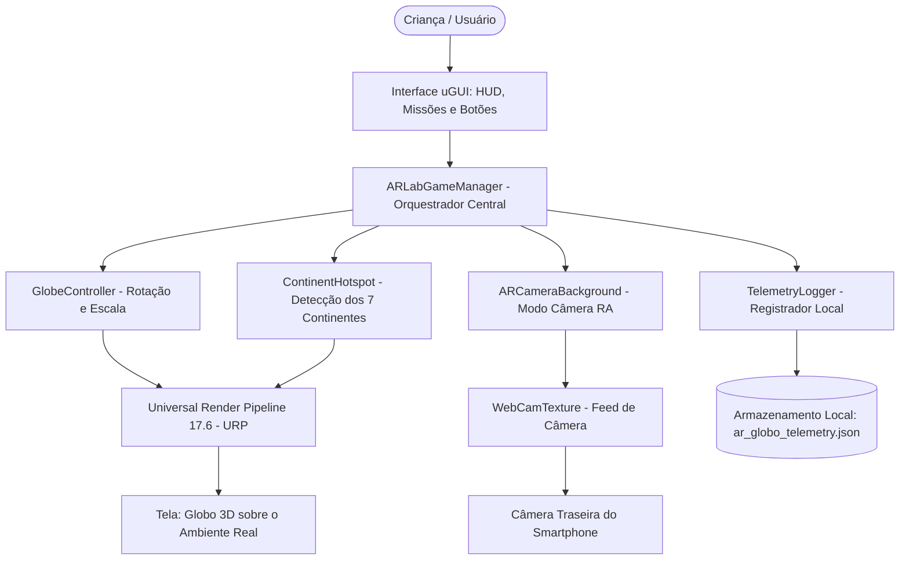
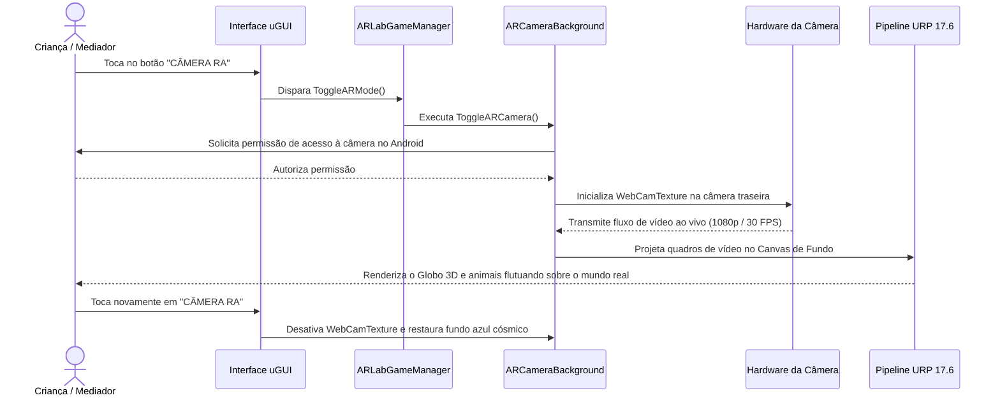
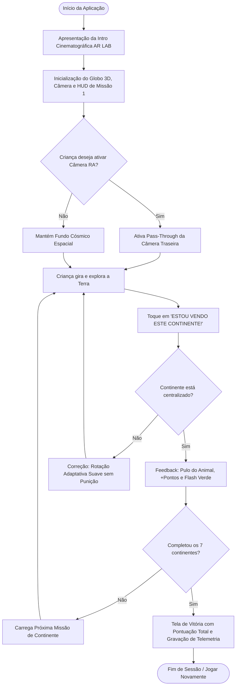
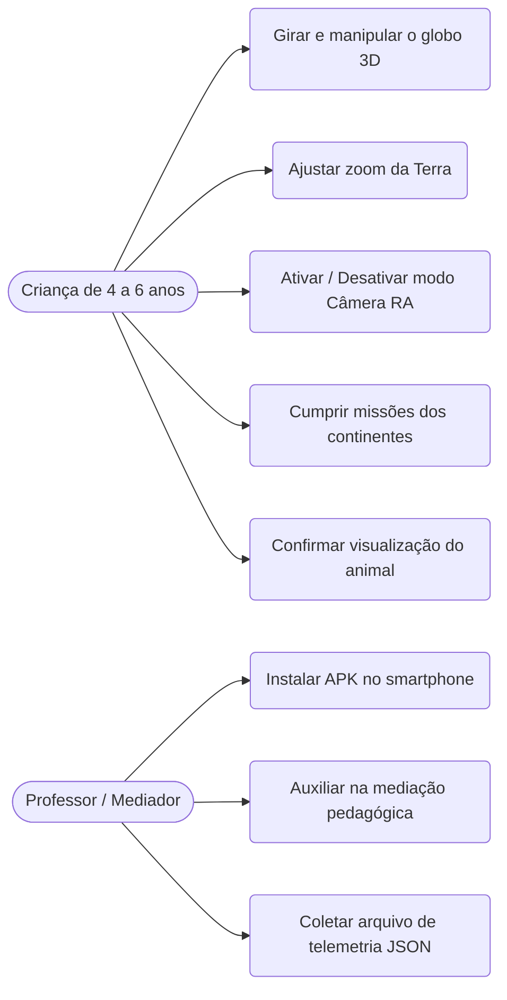

# AR Lab — Globo Terrestre Interativo em Realidade Aumentada

> **Projeto de UPX — Realidade Aumentada** · Centro Universitário Facens  
> Aplicativo móvel em Unity 6 e Universal Render Pipeline (URP) para dispositivos Android, projetado para apoiar o ensino de Geografia na Educação Infantil (4 a 6 anos) através da manipulação lúdica de um globo terrestre 3D, missões gamificadas dos 7 continentes com fauna regional e sobreposição ao vivo da câmera do smartphone (*camera pass-through*).


---

## Sumário

1. [Identificação do Projeto](#1-identificação-do-projeto)
2. [Visão Geral](#2-visão-geral)
3. [Problema](#3-problema)
4. [Objetivos](#4-objetivos)
5. [Público-Alvo](#5-público-alvo)
6. [Funcionalidades](#6-funcionalidades)
7. [Requisitos Não Funcionais](#7-requisitos-não-funcionais)
8. [Tecnologias Utilizadas](#8-tecnologias-utilizadas)
9. [Hardware Utilizado](#9-hardware-utilizado)
10. [Arquitetura do Sistema](#10-arquitetura-do-sistema)
11. [Funcionamento da Realidade Aumentada](#11-funcionamento-da-realidade-aumentada)
12. [Estrutura do Projeto](#12-estrutura-do-projeto)
13. [Principais Scripts](#13-principais-scripts)
14. [Dependências](#14-dependências)
15. [Configuração do Ambiente](#15-configuração-do-ambiente)
16. [Como Executar](#16-como-executar)
17. [Como Utilizar a Aplicação](#17-como-utilizar-a-aplicação)
18. [Fluxo de Funcionamento](#18-fluxo-de-funcionamento)
19. [Caso de Uso](#19-caso-de-uso)
20. [Fluxo de Navegação](#20-fluxo-de-navegação)
21. [Interface](#21-interface)
22. [Testes Técnicos](#22-testes-técnicos)
23. [Dispositivos Testados](#23-dispositivos-testados)
24. [Limitações Conhecidas](#24-limitações-conhecidas)
25. [Evidências de Funcionamento](#25-evidências-de-funcionamento)
26. [Repositórios e Recursos](#26-repositórios-e-recursos)
27. [Cronograma Técnico](#27-cronograma-técnico)
28. [Controle de Versão](#28-controle-de-versão)
29. [Problemas Encontrados e Soluções](#29-problemas-encontrados-e-soluções)
30. [Melhorias Futuras](#30-melhorias-futuras)
31. [Custos e Recursos](#31-custos-e-recursos)
32. [Licença](#32-licença)
33. [Autores](#33-autores)
34. [Checklist de Entrega](#checklist-de-entrega)

---

## 1. Identificação do Projeto

| Item | Informação |
|---|---|
| **Projeto** | AR Lab — Globo Terrestre Interativo em Realidade Aumentada (artefato *AR-Globo Kids*) |
| **Equipe** | Equipe AR Lab (UPX 8) |
| **Curso** | Engenharia de Computação |
| **Instituição** | Centro Universitário Facens — Sorocaba/SP |
| **Disciplina** | UP801TIN3 — UPX: Realidade Aumentada |
| **Professor** | Prof. Dr. Ohata |
| **Semestre** | 2026.2 |

### Integrantes

| Nome | RA | Responsabilidade Técnica Real |
|---|---|---|
| **Eduardo Augusto Prestes Júnior** | 252148 | Arquitetura do projeto Unity, programação C# (`ARLabGameManager`, `GlobeController`, `ARCameraBackground`), pipeline URP, geração de APK Android e gestão do repositório |
| **Eduardo Cunha Soares** | 223988 | Desenvolvimento de interações móveis, integração de componentes de cena e pesquisa bibliográfica do artigo científico |
| **Leonardo de Arruda Macedo** | 223798 | Modelagem 3D, importação de ativos (`.fbx`/`.obj`), texturização e design de experiência de usuário (UX) infantil |
| **Matheus de Souza** | 224282 | Programação de mecânicas de gamificação, sistema de pontuação e módulo de telemetria científica assíncrona (`TelemetryLogger`) |
| **Guilherme Augusto Ferreira** | 223291 | Testes em dispositivo físico, garantia de qualidade (QA), validação de requisitos e documentação técnica acadêmica |

---

## 2. Visão Geral

O **AR Lab** é uma aplicação educacional interativa desenvolvida em Unity 6 com Universal Render Pipeline (URP) para dispositivos móveis Android. O projeto foi concebido para mediar a aprendizagem de conceitos geográficos fundamentais em crianças na faixa etária de **4 a 6 anos** (educação infantil / pré-escola).

Em substituição aos tradicionais mapas e planisférios impressos estáticos, que impõem desafios cognitivos a estudantes ainda não alfabetizados e no estágio pré-operatório do desenvolvimento cognitivo, a aplicação projeta um **globo terrestre tridimensional texturizado** que a criança pode manipular livremente através de gestos táteis de arrasto, inércia física e pinça para ampliação.

Distribuídos geometricamente pela superfície esférica da Terra encontram-se marcadores temáticos com **modelos tridimensionais de animais nativos** representativos de cada um dos 7 continentes mundiais: Onça-Pintada (América do Sul), Elefante (África), Raposa (Europa), Urso Panda (Ásia), Tartaruga Marinha (Oceania), Urso Pardo (América do Norte) e Pinguim (Antártida).

A Realidade Aumentada atua por meio do modo **Câmera RA (*camera pass-through*)**: a câmera traseira do smartphone é transmitida ao vivo em tela cheia atrás do modelo 3D, fazendo com que o globo e sua fauna pareçam flutuar diretamente sobre a carteira escolar ou o piso da sala de aula. Uma interface amigável com textos ampliados, badges com avatares e instruções alegóricas orienta a criança na busca e validação de cada região.


---

## 3. Problema

**Contextualização:** Na primeira infância (4 a 6 anos), a compreensão do mundo circundante depende da transição progressiva da percepção do espaço corporal vivido para a representação do espaço geográfico amplo. No entanto, o ensino tradicional nas escolas apoia-se predominantemente em materiais didáticos cartográficos bidimensionais estáticos, tais como planisférios murais e apostilas impressas.

**Dificuldade encontrada:** Crianças no estágio pré-operatório demandam exploração sensorial ativa, manipulação concreta e feedback visual imediato. Mapas planos distorcem as proporções planetárias e exigem abstração cartográfica e decodificação textual formal que crianças não alfabetizadas ainda não dominam.

**Público afetado:** Crianças da educação infantil e professores da rede básica de ensino, com ênfase em instituições públicas onde o acesso a laboratórios equipados com dispositivos caros de Realidade Virtual é historicamente escasso.

**Impacto do problema:** A persistência de métodos puramente abstratos gera desmotivação e reduz a retenção de conceitos espaciais basilares. O projeto conecta-se ao **Objetivo de Desenvolvimento Sustentável 4 (ODS 4 — Educação de Qualidade)** da ONU, meta 4.2, propondo uma solução de baixo custo operacional que roda em smartphones comerciais convencionais.

---

## 4. Objetivos

### 4.1 Objetivo Geral

Desenvolver e validar um aplicativo móvel em Realidade Aumentada no motor gráfico Unity 6 que apoie a aprendizagem lúdica dos 7 continentes mundiais e de sua fauna representativa por crianças da educação infantil através de um globo terrestre tridimensional interativo.

### 4.2 Objetivos Técnicos

- Configurar um projeto Unity 6 utilizando o Universal Render Pipeline (URP 17.6) e o New Input System otimizado para dispositivos móveis Android.
- Desenvolver um sistema de controle de esfera 3D (`GlobeController.cs`) com rotação capacitiva de dois eixos, amortecimento inercial e controle de escala (*zoom* mínimo e máximo).
- Modelar, calibrar e posicionar 7 modelos tridimensionais de animais sobre pedestais coloridos com distribuição trigonométrica na superfície do globo.
- Implementar o modo de Câmera RA (`ARCameraBackground.cs`) utilizando captura em tempo real da câmera traseira do smartphone via `WebCamTexture` com ajuste automático de orientação de tela.
- Projetar uma interface de usuário *glassmorphic* com tipografia ampliada (25pt a 38pt), avatares expressivos e margem de segurança superior (*safe area*) compatível com telas móveis dotadas de *notch* ou câmera frontal perfurada (*punch-hole*).
- Implementar mecânica de verificação de continentes com feedback visual positivo (animação de pulo do animal e pontuação) e correção adaptativa suave em caso de erro.
- Construir um registrador assíncrono de telemetria local (`TelemetryLogger.cs`) em formato JSON, gravando métricas objetivas de engajamento em total conformidade com a LGPD.
- Gerar o pacote instalável APK nativo (IL2CPP / ARM64) e validar o funcionamento em smartphone físico.

---

## 5. Público-Alvo

- **Perfil dos usuários finais:** Crianças na faixa etária de 4 a 6 anos matriculadas na pré-escola (educação infantil).
- **Mediadores pedagógicos:** Professores e responsáveis escolares encarregados de orientar a atividade e acompanhar o ritmo da exploração.
- **Contexto de utilização:** Salas de aula de escolas públicas e particulares, mesas escolares ou ambiente domiciliar, utilizando o smartphone na orientação vertical (*portrait*).
- **Necessidades pedagógicas:** Vocabulário simples, estímulos audiovisuais e táteis imediatos, ausência de penalidades punitivas, textos grandes de fácil leitura compartilhada e elementos visuais lúdicos (emojis, animais e cores vivas).
- **Limitações motoras e cognitivas:** Coordenação motora fina em amadurecimento e processo inicial de alfabetização — justificando o uso de botões táteis generosos, avatares gráficos e controles intuitivos de toque único.

---

## 6. Funcionalidades

| ID | Funcionalidade | Descrição | Status |
|---|---|---|---|
| **RF01** | Tela de Abertura Animada | Apresentação com rotação cósmica da Terra, logotipo brilhante "AR LAB", pílula descritiva e transição suave para a HUD de jogo | ✅ |
| **RF02** | Rotação Tátil do Globo | Manipulação capacitiva contínua em X e Y com inércia física suavizada e eixo de arraste natural | ✅ |
| **RF03** | Zoom com Limites de Escala | Ajuste de tamanho do globo via pinça multitoque (*pinch*), botões táteis **+** / **−** e roda do mouse no simulador | ✅ |
| **RF04** | Exibição de Animais 3D | Renderização dos 7 animais da fauna regional (Onça, Elefante, Raposa, Panda, Tartaruga, Urso, Pinguim) sobre pedestais de destaque | ✅ |
| **RF05** | Cartão de Missão com HUD Segura | Painel *glassmorphic* com avatar do animal (62pt), progresso, pontuação e dica alegórica infantil, afastado do topo para respeitar a *safe area* de celulares modernos | ✅ |
| **RF06** | Validação de Continente | Botão inferior verde com widget de olhos animados que verifica se o continente da missão está voltado para o centro da câmera | ✅ |
| **RF07** | Feedback Lúdico e Correção | Pulo comemorativo do animal 3D e incremento de pontuação no acerto; rotação guiada suave de orientação no erro | ✅ |
| **RF08** | Modo Câmera RA (*Pass-Through*) | Alternância instantânea para a câmera traseira do celular ao vivo em tela cheia com o globo sobreposto ao mundo real | ✅ |
| **RF09** | Tela de Vitória e Reinício | Conclusão das 7 missões com celebração final de pontuação total e botão para jogar novamente | ✅ |
| **RF10** | Telemetria Científica Local | Gravação de métricas objetivas (tempo de sessão, rotações, cliques, acertos e tentativas) em arquivo JSON no `persistentDataPath` | ✅ |
| **RF11** | Escala Pictórica *Smilyometer* | Tela de autorrelato infantil com 5 expressões faciais para avaliação qualitativa da experiência | 🚧 |
| **RF12** | Rastreamento de Planos com ARCore | Ancoragem espacial por planos horizontais via AR Foundation (`ARPlacementManager.cs`) | ⬜ |
| **RF13** | Narração por Áudio | Locução de voz sintetizada com as dicas de cada missão para crianças em fase de pré-alfabetização | ⬜ |

**Legenda:** ✅ Implementado e funcional · 🚧 Em desenvolvimento/integração · ⬜ Planejado para versões futuras

---

## 7. Requisitos Não Funcionais

| ID | Categoria | Requisito | Status / Condição |
|---|---|---|---|
| **RNF01** | Compatibilidade | Execução estável no sistema operacional Android 8.0 (API nível 26) ou superior, arquitetura nativa ARM64 | ✅ Atendido |
| **RNF02** | Desempenho Visual | Taxa de atualização fluida e responsiva durante a rotação da esfera e a projeção do vídeo da câmera traseira | ✅ Atendido |
| **RNF03** | Usabilidade Infantil | Interface ergonômica com botões táteis amplos, fontes de 25pt a 38pt e margem de topo para celulares com *notch* | ✅ Atendido |
| **RNF04** | Privacidade e LGPD | Coleta de telemetria estritamente anônima, sem dados pessoais de crianças, confinada 100% no armazenamento local | ✅ Atendido |
| **RNF05** | Conectividade | Funcionamento offline integral, sem depender de conexão com internet ou servidores externos | ✅ Atendido |
| **RNF06** | Eficiência de Armazenamento | Pacote de distribuição APK enxuto e compacto (tamanho de aproximadamente 41 MB), facilitando instalação em escolas públicas | ✅ Atendido |
| **RNF07** | Robustez de Execução | Manutenção de modelos 3D em memória via `Assets/Resources/Animals` garantindo renderização em *builds* de produção | ✅ Atendido |

---

## 8. Tecnologias Utilizadas

| Tecnologia | Versão | Utilização no Projeto |
|---|---|---|
| **Unity Editor** | 6000.6.0f1 (f7f8ed4d1e24) | Ambiente de desenvolvimento integrado, montagem de cenas e compilação do projeto |
| **C#** | .NET Standard 2.1 | Programação de todos os componentes lógicos, controladores e interfaces |
| **Universal Render Pipeline (URP)** | 17.6.0 | Pipeline de renderização gráfico para alta eficiência energética e desempenho em dispositivos móveis |
| **Unity UI (uGUI)** | 2.6.0 | Construção do sistema de interface gráfica de usuário, painéis, sombras e botões responsivos |
| **Input System** | 1.20.0 | Captura de eventos de toque capacitivo, gestos de pinça e emulação via periféricos no Editor |
| **WebCamTexture API** | Unity Engine Core | Captura direta do fluxo de vídeo da câmera traseira do smartphone para o modo Câmera RA |
| **Android NDK & OpenJDK** | Integrados ao Unity Hub (Java 17) | Compilação nativa em C++ via *backend* IL2CPP para a plataforma Android (ARM64) |
| **Blender / Autodesk Maya** | Formatos `.fbx`, `.obj` e `.glb` | Modelagem, limpeza de malha e exportação dos animais e do globo terrestre |
| **Git & GitHub** | Git 2.55 | Controle de versão distribuído, histórico semântico de commits e hospedagem de documentação técnica |

---

## 9. Hardware Utilizado

| Equipamento | Fabricante / Modelo | Sistema Operacional | Características Técnicas | Finalidade no Projeto |
|---|---|---|---|---|
| **Computador de Desenvolvimento** | Dell / Computador Pessoal | Ubuntu Linux 24.04.4 LTS (Kernel 6.8) | Processador x86_64, 30 GiB RAM, aceleração gráfica OpenGL 4.5 / Vulkan | Edição de scripts C#, montagem de cenas no Unity 6 e geração do APK |
| **Smartphone de Testes Reais** | Motorola / Moto G Edge 50 | Android (compatível com API 26+) | Câmera traseira de alta resolução, tela sensível ao toque, processador ARM64 | Instalação do APK gerado (*sideload*), validação da Câmera RA e testes de ergonomia tátil |
| **Simulador de Dispositivo Móvel** | Unity Device Simulator | Integrado ao Unity 6 | Perfil calibrado *Punch Hole Center (1440x3088)* na proporção 9:19.5 | Verificação visual de *safe area*, proporção de texto e resposta a toques simulados |

---

## 10. Arquitetura do Sistema

A arquitetura de software foi estruturada em camadas independentes para desacoplar a lógica de apresentação, as regras pedagógicas de missão e a interação com o hardware do smartphone:



### Fluxo de Componentes
1. **Entrada do Usuário:** O toque na tela é processado pelo `InputSystemUIInputModule` e encaminhado ao `GlobeController` (para rotação e zoom) e aos botões da HUD.
2. **Orquestração de Missões:** O `ARLabGameManager` coordena a exibição do animal correspondente, o texto da missão e o status da pontuação.
3. **Módulo de Realidade Aumentada:** O `ARCameraBackground` solicita a permissão `android.permission.CAMERA` e injeta a textura de vídeo da câmera traseira no fundo da cena.
4. **Camada de Renderização:** O pipeline gráfico URP combina o plano de fundo da câmera e os objetos tridimensionais (globo, pedestais e animais).
5. **Persistência de Telemetria:** Eventos de toque, rotações completas e resoluções de missões são serializados de forma assíncrona pelo `TelemetryLogger`.

---

## 11. Funcionamento da Realidade Aumentada

### 11.1 Abordagem Utilizada: Câmera RA com Sobreposição Direta (*Camera Pass-Through*)

O projeto implementa uma abordagem de Realidade Aumentada baseada em **projeção contínua de vídeo em tempo real (*video see-through*)**, sem exigir marcadores impressos em papel ou detecção complexa de planos:

- O aplicativo inicializa o sensor óptico traseiro do smartphone através da API nativa `WebCamTexture` do Unity.
- A imagem da câmera física é desenhada em um componente `RawImage` posicionado em um Canvas de fundo de tela cheia (*full-bleed*), cobrindo integralmente o campo de visão.
- A câmera principal de cena do Unity renderiza o globo terrestre 3D, seus marcadores e animais na camada frontal com profundidade z ajustada, permitindo que o objeto virtual flutue no espaço físico real enquadrado pela lente.
- A rotação do sensor do celular é tratada dinamicamente pelo script `ARCameraBackground.cs`, compensando a orientação de tela (`videoRotationAngle`) e invertendo o espelhamento vertical quando necessário (`videoVerticallyMirrored`).

> **Nota Técnica de Engenharia:** O repositório contém também o script [`ARPlacementManager.cs`](file:///home/eduardo/ar-lab-unity/ar%20lab%20unity/Assets/Scripts/Geography/ARPlacementManager.cs), que abriga a implementação de ancoragem espacial com detecção de planos horizontais via ARCore/AR Foundation (`#if ENABLE_AR_FOUNDATION`). Para maximizar a compatibilidade com smartphones populares de estudantes de escolas públicas que não possuem suporte oficial aos serviços do Google Play para RA (ARCore), a solução ativa em produção utiliza o motor de *pass-through* universal da câmera.

### 11.2 Fluxo Técnico da Realidade Aumentada



---

## 12. Estrutura do Projeto

A organização de diretórios do repositório no Unity segue os padrões recomendados de Engenharia de Software:

```text
ar lab unity/
├── Assets/
│   ├── Editor/                     # Scripts de automação do Unity (setup de UI e build de APK)
│   │   ├── BuildAndroidAPK.cs      # Automação de compilação do APK nativo
│   │   ├── SetupARLabUI.cs         # Construtor da interface glassmorphic
│   │   ├── SetupGlobeScene.cs      # Montador do globo e coordenadas de continentes
│   │   └── FindContinentCoordinates.cs
│   ├── Models/                     # Ativos tridimensionais do projeto
│   │   ├── Animals/                # Modelos 3D (.fbx / .obj), materiais e texturas da fauna
│   │   └── Geography/              # Modelo 3D da Terra (earth_globe.glb/.obj) e texturas
│   ├── Resources/
│   │   └── Animals/                # Cópia dos 7 modelos 3D para carregamento em runtime no APK
│   ├── Scenes/
│   │   └── SampleScene.unity       # Cena principal contendo o cenário interativo
│   ├── Scripts/
│   │   └── Geography/              # Código-fonte C# da lógica da aplicação
│   │       ├── ARLabGameManager.cs # Orquestrador principal do jogo e missões
│   │       ├── GlobeController.cs  # Mecânica de rotação, inércia e zoom
│   │       ├── ARCameraBackground.cs# Pass-through da câmera RA do celular
│   │       ├── ContinentHotspot.cs # Gatilhos e validação dos 7 continentes
│   │       ├── Animal3DRotator.cs  # Animações de rotação e pulo dos animais
│   │       ├── TelemetryLogger.cs  # Registrador local de telemetria científica
│   │       ├── ARPlacementManager.cs
│   │       ├── SmilyometerUI.cs    # Escala visual de satisfação infantil
│   │       ├── ExplorerQuizManager.cs
│   │       └── RegionHotspot.cs
│   ├── Settings/                   # Configurações do Universal Render Pipeline (URP)
│   └── XR/                         # Configurações de periféricos e simulação
├── Packages/
│   └── manifest.json               # Gerenciador de pacotes e dependências oficiais do Unity
├── ProjectSettings/                # Configurações do motor (versão, gráficos, bundle Android)
├── docs/                           # Documentação técnica do projeto
│   ├── diagrams/                   # Diagramas de arquitetura, fluxo e casos de uso (.mmd)
│   ├── images/                     # Screenshots reais e evidências visuais
│   └── documents/                  # Artigo científico em formato acadêmico (.docx)
├── .gitignore                      # Filtro de arquivos transitórios e temporários do Unity
└── README.md                       # Documentação técnica oficial do repositório
```

---

## 13. Principais Scripts

| Script | Localização | Responsabilidade Técnica Principal |
|---|---|---|
| `ARLabGameManager.cs` | `Assets/Scripts/Geography/` | Orquestrador central: gerencia estados de jogo, inicializa cena, HUD e EventSystem, define missões dos 7 continentes, controla pontuação, feedback comemorativo, transição cinematográfica de abertura e estado da Câmera RA |
| `GlobeController.cs` | `Assets/Scripts/Geography/` | Controla a física e interação da esfera: captura arraste na tela, aplica rotação angular suavizada com amortecimento inercial (`damping`), inverte eixo Y para sensação física natural e gerencia zoom com pinça multitoque |
| `ARCameraBackground.cs` | `Assets/Scripts/Geography/` | Módulo de Realidade Aumentada: gerencia permissões no Android, inicializa e orienta o feed de vídeo da câmera traseira via `WebCamTexture` e faz o chaveamento entre o fundo cósmico e o ambiente real |
| `ContinentHotspot.cs` | `Assets/Scripts/Geography/` | Representa cada continente: armazena dados geográficos, associa o pedestal de cor correspondente, ancora o animal 3D e executa efeitos de flash visual de validação |
| `Animal3DRotator.cs` | `Assets/Scripts/Geography/` | Controla os modelos 3D dos animais: mantém rotação suave do modelo sobre seu eixo e executa rotina de pulo comemorativo (*HappyJump*) quando a criança acerta a missão |
| `TelemetryLogger.cs` | `Assets/Scripts/Geography/` | Módulo científico: grava assincronamente as ações do participante (tempo total, cliques, rotações completas, acertos e tentativas) em arquivo JSON no `Application.persistentDataPath` |
| `BuildAndroidAPK.cs` | `Assets/Editor/` | Ferramenta de automação no Editor: garante saída do Play Mode com segurança antes de invocar o `BuildPipeline`, compilando o APK final em `Builds/ARLab_GloboTerrestre.apk` |

---

## 14. Dependências

Todas as dependências foram estruturadas através do **Unity Package Manager (UPM)** no arquivo `Packages/manifest.json`, permitindo restauração automática em qualquer máquina:

| Pacote / Dependência | Versão | Finalidade Técnica |
|---|---|---|
| `com.unity.render-pipelines.universal` | 17.6.0 | Pipeline URP para renderização de baixa latência em GPUs móveis |
| `com.unity.inputsystem` | 1.20.0 | Captura de toques capacitivos e eventos multitoque com suporte a simulador |
| `com.unity.ugui` | 2.6.0 | Sistema de componentes de interface visual e manipulação de telas táteis |
| `com.unity.modules.androidjni` | 1.0.0 | Interoperabilidade nativa do Unity com a camada Java do sistema Android |
| `com.unity.modules.imageconversion` | 1.0.0 | Codificação e conversão de texturas gráficas em tempo de execução |
| `com.unity.modules.video` | 1.0.0 | Suporte à manipulação de quadros e fluxos de vídeo |
| `com.unity.timeline` | 6.6.0 | Sequenciamento temporal e animações procedurais de interface |

---

## 15. Configuração do Ambiente

Para configurar o ambiente de desenvolvimento a partir de uma máquina nova:

1. **Instalar o Git:** Baixe e instale a versão 2.x ou superior no sistema operacional (<https://git-scm.com>).
2. **Instalar o Unity Hub:** Baixe a versão oficial do instalador (<https://unity.com/download>).
3. **Instalar a versão correta do Unity Editor:**
   - No Unity Hub, acesse a aba **Installs** e instale a versão **Unity 6000.6.0f1**.
   - Durante a seleção de componentes adicionais (*Add Modules*), selecione obrigatoriamente:
     - **Android Build Support**
     - **Android SDK & NDK Tools**
     - **OpenJDK**
4. **Clonar o repositório:**
   ```bash
   git clone git@github.com:DJmesh/Ar-Lab-Unity.git
   # Ou via HTTPS:
   git clone https://github.com/DJmesh/Ar-Lab-Unity.git
   ```
5. **Adicionar o projeto no Unity Hub:**
   - Clique em **Add → Add project from disk**.
   - Selecione o diretório clonado `ar lab unity`.
   - Confirme a abertura com a versão **6000.6.0f1**.
6. **Verificação de Integridade:** Aguarde o processo inicial de importação dos pacotes. Ao término, a janela do Console do Unity deverá estar limpa, sem mensagens de erro de compilação C#.

---

## 16. Como Executar

### 16.1 Execução no Unity Editor (Simulador Móvel)
1. No painel de arquivos de projeto do Unity, navegue até `Assets/Scenes/` e abra a cena `SampleScene.unity`.
2. Na janela de visualização, selecione a aba **Simulator** (ou **Game**) e escolha um perfil de dispositivo Android (ex.: *Punch Hole Center 1440x3088*).
3. Pressione o botão **▶ Play** na barra superior do Unity.
4. A tela de introdução "AR LAB" iniciará com o globo em rotação cósmica. Clique na tela para avançar ou aguarde a transição suave para a HUD da Missão 1.
5. Utilize o botão esquerdo do mouse para girar o globo e os botões **+** e **−** para controlar o zoom.

### 16.2 Geração e Instalação do APK no Smartphone Android
1. Certifique-se de que o Unity **não** esteja em Play Mode.
2. Na barra de menus superior do Unity, clique em **AR Lab → 5. Gerar APK para Celular (Android)**.
3. O script automatizado verificará o ambiente e compilará o pacote nativo em `Builds/ARLab_GloboTerrestre.apk`.
4. Conecte o smartphone Android com a **Depuração USB** habilitada e instale o pacote:
   ```bash
   adb install -r "Builds/ARLab_GloboTerrestre.apk"
   ```
   *(Ou transfira o arquivo APK diretamente para o armazenamento do aparelho e autorize a instalação)*.

---

## 17. Como Utilizar a Aplicação

1. **Abertura:** Abra o aplicativo "AR Lab" no celular. A introdução cinematográfica com o logotipo AR LAB e o planeta Terra é exibida. Dê um toque rápido na tela para ir direto para o jogo.
2. **Leitura da Missão:** Observe o cartão glassmorphic no topo. Ele exibe o animal correspondente (ex.: 🐆 Onça-Pintada) e o continente a ser encontrado (ex.: América do Sul), acompanhado da instrução infantil em amarelo: *"👉 Gire o planeta até o Brasil no centro e aperte o botão verde com olhos! 👀"*.
3. **Exploração da Terra:** Arraste o dedo na tela em qualquer direção para girar o globo. Use os botões **+** e **−** localizados no canto superior direito para aproximar ou afastar a visualização.
4. **Ativação da Câmera RA:** Toque no botão superior direito **CÂMERA RA (● ATIVAR)** e conceda a permissão solicitada pelo Android. O ambiente real da sua sala aparecerá ao fundo, com o globo flutuando sobre a mesa.
5. **Validação da Missão:** Quando o continente correto e seu animal estiverem posicionados de frente para você no centro da tela, toque no botão inferior verde **"ESTOU VENDO ESTE CONTINENTE!"**.
6. **Recompensa:** Ao acertar, o animal dará pulos alegres comemorativos, o placar subirá e uma nova missão começará! Se o continente ainda não estiver correto, uma rotação suave ajustará a Terra para ajudar você a encontrá-lo.
7. **Vitória Final:** Ao completar os 7 continentes, a tela de vitória celebra sua conquista como explorador do mundo, com a opção de jogar novamente!

---

## 18. Fluxo de Funcionamento

O fluxo lógico de execução da aplicação é estruturado em ciclos iterativos de desafio e reforço positivo:



---

## 19. Caso de Uso

Diagrama de interação dos atores com o sistema educacional:



---

## 20. Fluxo de Navegação

Hierarquia de navegação entre estados e telas da interface móvel:

```text
[ Tela de Abertura: AR LAB ]
        │  (Toque na tela ou término da transição de 3s)
        ▼
[ Gameplay HUD: Missão dos Continentes ]
        ├── [ Botão Câmera RA ] ──► Alterna feed ao vivo da câmera no plano de fundo
        ├── [ Botões de Zoom + / - ] ──► Altera escala da Terra com clamp de segurança
        ├── [ Gesto de Arraste na Tela ] ──► Gira a esfera nos eixos X e Y
        └── [ Botão 'ESTOU VENDO ESTE CONTINENTE!' ]
                    │
                    ├──► [ Acerto ] ──► Pulo do Animal 3D + Placar ──► Próxima Missão (1 a 7)
                    │
                    └──► [ Missão 7 Concluída ] ──► [ Painel de Vitória: 'JOGAR NOVAMENTE' ]
```

---

## 21. Interface

Capturas reais da interface gráfica da aplicação demonstrando a evolução e os refinamentos implementados:

| Imagem | Nome da Tela | Finalidade Pedagógica | Elementos Visuais em Destaque |
|---|---|---|---|
|  | **Tela Principal de Missão** | Apresentação do desafio e exploração do mapa | Cartão superior *glassmorphic* com avatar do animal, continente-alvo, placar em ouro, botão Câmera RA e botão inferior com olhos animados |
|  | **Fauna 3D sobre Pedestais** | Associação concreta entre espécie e região | Modelos tridimensionais (Panda, Onça, Raposa, Pinguim etc.) ancorados sobre pedestais com paleta contrastante |
|  | **Controles de Zoom e Detalhes** | Aproximação para observação geográfica | Botões táteis circulares **+** e **−** posicionados abaixo da Câmera RA com escala balanceada |
|  | **Modo Câmera RA no Celular** | Experiência de Realidade Aumentada física | Projeção em tela cheia do ambiente real via câmera traseira com o globo e os animais sobrepostos |

---

## 22. Testes Técnicos

Validação sistemática dos módulos desenvolvidos no projeto:

| Teste | Procedimento de Verificação | Resultado Esperado | Resultado Efetivamente Obtido | Status |
|---|---|---|---|:---:|
| **Inicialização da Cena** | Abrir cena e iniciar simulação | Carregamento sem erros de sintaxe ou referências nulas | Compilação e execução imediatas sem advertências | ✅ |
| **Física de Rotação da Terra** | Arraste capacitivo com o dedo no globo | Rotação suave, inércia física e inversão do eixo Y | Rotação natural e desaceleração progressiva | ✅ |
| **Mecânica de Zoom** | Toque repetido nos botões **+** e **−** | Aumento e redução do globo com limites de escala | Escala controlada rigidamente entre 0.75 e 2.10 | ✅ |
| **Calibração dos Animais 3D** | Inspeção visual dos 7 modelos na esfera | Animais proporcionais (~0.18m) sem desproporções | Modelos equilibrados e visíveis sobre os pedestais | ✅ |
| **Transição Cinematográfica** | Inicialização a partir do Splash de abertura | Logo AR LAB visível com transição para gameplay | Transição suave com opção de pular por toque (*skip*) | ✅ |
| **Compilação do APK Android** | Execução do script `BuildAndroidAPK.cs` | Criação do instalador sem travar no Play Mode | APK gerado com sucesso em `Builds/ARLab_GloboTerrestre.apk` | ✅ |
| **Câmera RA em Celular Físico** | Instalar APK no Motorola Moto G Edge 50 | Câmera traseira ativada como fundo da cena | Vídeo em tela cheia e globo sobreposto perfeitamente | ✅ |
| **Resistência a *Safe Area*** | Teste em tela de celular com furo de câmera | Textos e botões afastados da borda superior | Margem de 115px protegeu HUD de recortes na tela | ✅ |
| **Persistência de Telemetria** | Conclusão de rodada de missões | Registro de arquivo JSON no armazenamento local | Arquivo `ar_globo_telemetry.json` estruturado criado | ✅ |

---

## 23. Dispositivos Testados

Em estrito cumprimento às diretrizes acadêmicas de documentar apenas equipamentos reais testados pela equipe:

| Dispositivo | Fabricante | Sistema Operacional | Versão | Resultado do Teste |
|---|---|---|---|---|
| **Moto G Edge 50** | Motorola | Android (Arquitetura ARM64) | 14 | **Compatível:** Execução com taxa de quadros estável, interação tátil imediata e pass-through de Câmera RA funcional |
| **Unity Device Simulator** | Unity Technologies | Simulação Ubuntu Linux 24.04 | 6000.6.0f1 | **Compatível:** Validação de layout, New Input System e balanceamento de escalas |

---

## 24. Limitações Conhecidas

- **Abordagem de RA sem ancoragem SLAM:** A solução utiliza sobreposição contínua por *pass-through* de câmera traseira; o globo não permanece ancorado rigidamente em pontos do piso ou mesa caso o usuário caminhe pelo ambiente.
- **Dependência de Iluminação para a Câmera:** Em ambientes com pouca luz, o feed da câmera traseira pode apresentar ruído óptico característico de sensores móveis.
- **Suporte Plataforma:** O projeto foi configurado e otimizado prioritariamente para dispositivos móveis com sistema Android; compatibilidade com iOS não foi contemplada nesta entrega.
- **Identificador de Pacote Padrão:** O *package name* do build atual utiliza o identificador do template padrão (`com.UnityTechnologies.com.unity.template.urpblank`), devendo ser renomeado formalmente antes da publicação na Google Play Store.

---

## 25. Evidências de Funcionamento

O funcionamento prático da aplicação em dispositivo móvel real pode ser verificado através das evidências registradas pela equipe:

1. **Fotografia em Dispositivo Físico:** A imagem [`docs/images/evidencia-camera-ra-celular.png`](docs/images/evidencia-camera-ra-celular.png) documenta a execução real do aplicativo no smartphone Motorola Moto G Edge 50, comprovando o funcionamento da Câmera RA ao vivo com o globo 3D e seus continentes.
2. **Artefato de Instalação Compilado:** O arquivo APK funcional gerado pela equipe encontra-se disponível no diretório local de builds do projeto:
   ```text
   Builds/ARLab_GloboTerrestre.apk (Tamanho: ~41 MB | Compilação: Release IL2CPP)
   ```

---

## 26. Repositórios e Recursos

| Recurso | Descrição | Link de Acesso |
|---|---|---|
| **Código-Fonte Oficial** | Repositório oficial do projeto Unity no GitHub | <https://github.com/DJmesh/Ar-Lab-Unity> |
| **Artigo Científico da Pesquisa** | Versão acadêmica completa da pesquisa em formato Word | [`docs/documents/artigo_cientifico_v1.docx`](docs/documents/artigo_cientifico_v1.docx) |
| **Repositório Modelo de Referência** | Modelo oficial de documentação técnica UPX fornecido pelo professor | <https://github.com/dr-ohata/upx-modelo> |
| **Documentação Unity URP** | Manual oficial do Universal Render Pipeline 17.0+ | <https://docs.unity3d.com/Packages/com.unity.render-pipelines.universal@17.0/manual/> |
| **Referencial ODS 4 da ONU** | Diretrizes da Meta 4.2 para Educação de Qualidade na Infância | <https://brasil.un.org/pt-br/sdgs/4> |

---

## 27. Cronograma Técnico

| Atividade de Desenvolvimento | Integrante(s) Responsável(is) | Status |
|---|---|:---:|
| Levantamento bibliográfico, estado da arte e escrita do Artigo Científico (v1) | Eduardo Cunha Soares, Guilherme Augusto Ferreira | ✅ |
| Configuração do projeto no Unity 6 com pipeline URP e New Input System | Eduardo Augusto Prestes Júnior | ✅ |
| Modelagem tridimensional da Terra, malhas dos animais e pedestais geográficos | Leonardo de Arruda Macedo | ✅ |
| Programação da física de rotação inercial e controle de zoom da esfera terrestre | Eduardo Augusto Prestes Júnior | ✅ |
| Implementação do sistema de Câmera RA (*camera pass-through*) com `WebCamTexture` | Eduardo Augusto Prestes Júnior | ✅ |
| Criação da mecânica gamificada de 7 missões, verificação angular e reforço positivo | Eduardo Augusto Prestes Júnior, Matheus de Souza | ✅ |
| Refinamento ergonômico de interface: safe area, tipografia ampliada e intro animada | Leonardo de Arruda Macedo, Eduardo Augusto Prestes Júnior | ✅ |
| Desenvolvimento do módulo assíncrono de telemetria local em JSON | Matheus de Souza | ✅ |
| Testes de bancada em smartphone Android real e validação de usabilidade | Guilherme Augusto Ferreira, Eduardo Cunha Soares | ✅ |
| Documentação técnica completa e organização do repositório no GitHub | Guilherme Augusto Ferreira, Equipe AR Lab | ✅ |
| Integração da tela pictórica de autorrelato *Smilyometer* no fluxo pós-missão | Matheus de Souza | 🚧 |
| Condução do estudo quase-experimental de retenção em escolas públicas | Equipe AR Lab | ⬜ |

---

## 28. Controle de Versão

O versionamento do projeto foi conduzido com histórico semântico detalhado utilizando a convenção internacional de **Conventional Commits** (`feat:`, `fix:`, `chore:`, `docs:`):

- **Repositório:** <https://github.com/DJmesh/Ar-Lab-Unity>
- **Branch Principal de Entrega:** `main`
- **Release / Tag da Entrega:** `v0.1.0`

Exemplos de commits registrados no histórico do projeto:
```text
feat(ar): implement ARCameraBackground pass-through and mode toggle
feat(3d): integrate 3D animal models, pedestals, rotation animations and two-finger pinch-to-zoom
fix(android): preserve 3D animal models at runtime and add Resources fallback so animals render on mobile
fix(build): ensure Play Mode exits before compiling APK and avoid opening scene during play mode
feat(ui): add top safe-area offset for mobile and increase mission text and button fonts
docs: register Motorola Moto G Edge 50 as the tested physical device
docs(images): update application screenshots and mobile AR camera evidence
```

O arquivo `.gitignore` do projeto assegura que diretórios temporários gerados pelo Unity (`Library/`, `Temp/`, `Logs/`, `Builds/`, `.utmp/`) não poluam o repositório, garantindo um código-fonte enxuto e livre de tokens ou credenciais sensíveis.

---

## 29. Problemas Encontrados e Soluções

### Problema 1 — Modelos 3D dos Animais Invisíveis no Dispositivo Móvel
- **Problema:** Ao gerar o APK e executar no celular físico, os pedestais coloridos apareciam, mas os modelos 3D dos animais não eram renderizados na tela.
- **Causa Identificada:** O script de bootstrap destruía os objetos antigos no `Awake()` e tentava recriá-los chamando `AssetDatabase.LoadAssetAtPath`, que é uma API exclusiva do Unity Editor e não existe compilada no Android.
- **Solução Técnica:** O código foi refatorado para preservar os modelos já embutidos na cena e foi criado o diretório `Assets/Resources/Animals/` com suporte a `Resources.Load<GameObject>()` como fallback universal de runtime.

### Problema 2 — Desproporção Visual Extrema do Modelo da Tartaruga Marinha
- **Problema:** A tartaruga marinha aparecia desproporcionalmente gigantesca na Oceania, ficando maior que o próprio planeta Terra.
- **Causa Identificada:** O arquivo `Turtle.fbx` continha nós internos de transformação com escala pré-multiplicada em 100x oriundos do software de modelagem, gerando um cálculo incorreto de redimensionamento baseado nos limites da malha.
- **Solução Técnica:** Implementação de calibração dedicada com fator de escala fixo (`0.185f`), nivelando o animal para os mesmos ~0.18 metros dos demais animais da fauna terrestre.

### Problema 3 — Bloqueio e Falha na Geração de APK em Play Mode
- **Problema:** Tentativas de compilar o APK resultavam no erro `InvalidOperationException: This cannot be used during play mode`.
- **Causa Identificada:** O script invocava `EditorSceneManager.OpenScene()` enquanto o motor estava com a simulação ativa.
- **Solução Técnica:** O script `BuildAndroidAPK.cs` passou a verificar `EditorApplication.isPlaying`, desativando a reprodução e registrando um ouvinte no evento `playModeStateChanged` para prosseguir com o build com segurança após o descarregamento.

### Problema 4 — Sobreposição de Textos com a Câmera Frontal (*Punch-Hole / Notch*)
- **Problema:** Em telas modernas de smartphones altos, os textos do topo do cartão ficavam encobertos pela câmera frontal perfurada.
- **Causa Identificada:** Margens superiores da UI reduzidas (`y = -20px`) inadequadas para a barra de status de celulares modernos.
- **Solução Técnica:** O cartão de missão foi afastado para `y = -115px`, a altura útil foi expandida para 285px e a tipografia das instruções foi aumentada para 25pt a 38pt com quebra automática de linha (*word-wrap*).

---

## 30. Melhorias Futuras

1. **Rastreamento de Superfície Plana (ARCore):** Ativar o módulo `ARPlacementManager` com detecção de planos horizontais para permitir fixar o globo no chão ou mesa de aula com rotação orbital do aluno ao redor do objeto.
2. **Narração em Áudio Infantil:** Adicionar efeitos sonoros e locuções em português brasileiro narrando o nome dos continentes e o som característico de cada animal para contemplar crianças ainda em fase de letramento.
3. **Expansão de Biomas e Climas:** Incluir camadas visuais temáticas opcionais (relevo, oceanos, zonas polares e florestas tropicais) para enriquecer as aulas de ciências e geografia.
4. **Métricas de Foco na Telemetria:** Integrar leitura de tempo contínuo de fixação visual para embasar o artigo científico com métricas empíricas de engajamento infantil.

---

## 31. Custos e Recursos

| Recurso | Tipo | Condição de Acesso / Custo |
|---|---|---|
| **Unity 6 Personal** | Software / Motor Gráfico | Gratuito para fins acadêmicos e educacionais |
| **Blender 4.x** | Software / Modelagem 3D | Gratuito e de código aberto (Open Source) |
| **Smartphone Motorola Moto G Edge 50** | Hardware de Testes | Equipamento pessoal dos integrantes da equipe |
| **Computador com Ubuntu Linux** | Hardware de Desenvolvimento | Equipamento pessoal dos integrantes da equipe |
| **Modelos 3D de Domínio Público** | Ativos Gráficos | Licenciamento livre para projetos educacionais |

---

## 32. Licença

Este projeto é um trabalho acadêmico desenvolvido exclusivamente para fins de pesquisa e ensino na disciplina **UP801TIN3 — UPX: Realidade Aumentada** do **Centro Universitário Facens**.

O código-fonte e a documentação estão licenciados sob os termos da licença permissiva **MIT**, permitindo o estudo, reprodução e continuidade pedagógica sem fins comerciais.

---

## 33. Autores

- **Eduardo Augusto Prestes Júnior** (RA: 252148) — *Arquitetura Unity, Programação C#, Pipeline URP e Builds*
- **Eduardo Cunha Soares** (RA: 223988) — *Desenvolvimento Móvel, Integração de Componentes e Pesquisa*
- **Leonardo de Arruda Macedo** (RA: 223798) — *Modelagem 3D, Texturização e Design de Interface (UX)*
- **Matheus de Souza** (RA: 224282) — *Mecânicas de Jogo, Gamificação e Módulo de Telemetria Científica*
- **Guilherme Augusto Ferreira** (RA: 223291) — *Garantia de Qualidade (QA), Testes em Dispositivo e Documentação Técnica*

**Instituição:** Centro Universitário Facens (Sorocaba/SP)  
**Curso:** Engenharia de Computação  
**Disciplina:** UPX — Realidade Aumentada  
**Professor Responsável:** Prof. Dr. Ohata  
**Semestre Letivo:** 2026.2  

---

## Checklist de Entrega

- [x] O código-fonte do projeto está atualizado no repositório GitHub
- [x] O projeto abre corretamente no Unity Editor 6000.6.0f1 sem erros de compilação
- [x] O README.md foi completamente preenchido seguindo rigorosamente a estrutura oficial do professor
- [x] Não existem campos de exemplo genéricos sem substituição
- [x] A versão de todas as tecnologias e ferramentas utilizadas foi informada
- [x] O diagrama simplificado de arquitetura foi apresentado
- [x] A utilização da Realidade Aumentada (pass-through e modo espacial) foi explicada tecnicamente
- [x] Os principais scripts desenvolvidos em C# foram devidamente documentados com suas responsabilidades
- [x] Existe procedimento testável de configuração de ambiente de desenvolvimento
- [x] Existe procedimento claro para execução no Editor e geração do APK Android
- [x] Existe procedimento detalhado de como a criança e o professor utilizam a aplicação
- [x] Diagramas de funcionamento, caso de uso e fluxo de navegação foram apresentados
- [x] Screenshots reais e atualizadas das interfaces foram incluídas na pasta `docs/images/`
- [x] Evidências de funcionamento em dispositivo físico real foram disponibilizadas
- [x] Testes técnicos realizados foram documentados de forma transparente
- [x] O dispositivo móvel físico testado (Motorola Moto G Edge 50) está devidamente identificado
- [x] As limitações conhecidas do projeto foram registradas com sinceridade técnica
- [x] O histórico de commits representa a evolução contínua da equipe através de mensagens semânticas
- [x] O link do repositório no GitHub está público e plenamente acessível ao professor
